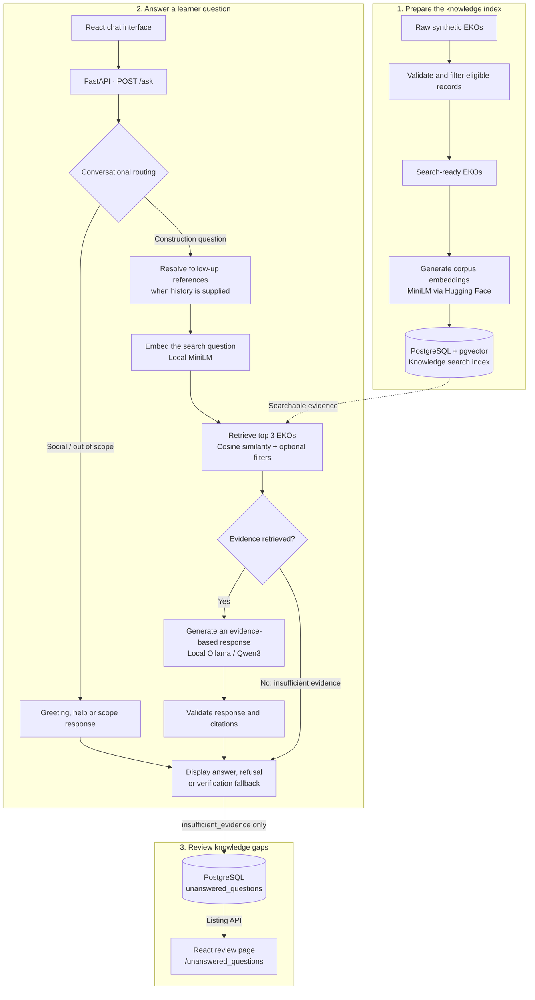

# SiteSeer 2B — AI Query Layer

SiteSeer Project 2B is a construction knowledge assistant prototype. Learners ask questions in a React interface; the backend retrieves Educational Knowledge Objects (EKOs), generates an answer from that evidence, and links citations to retrieved objects. Questions with insufficient supporting evidence are stored for knowledge-gap review.

**Status:** Development prototype using synthetic data. Integration with approved Project 2A knowledge and production deployment remain pending. The PostgreSQL search index is a derived resource, not the authoritative SiteSeer knowledge source.

This guide describes the checked-in implementation as reviewed on **22 November 2026**. Follow the local setup below for the current application; some component guides and deployment files retain earlier hosted-inference instructions.

## Contents

- [Architecture and repository map](#architecture-and-repository-map)
- [Local installation](#local-installation)
- [Run and use the prototype](#run-and-use-the-prototype)
- [API and response behaviour](#api-and-response-behaviour)
- [Update the knowledge corpus](#update-the-knowledge-corpus)
- [Evaluation and checks](#evaluation-and-checks)
- [Troubleshooting](#troubleshooting)
- [Docker Compose status](#docker-compose-status)
- [Handover and limitations](#handover-and-limitations)

## Architecture and repository map

### Architecture

The system has three connected flows: preparing knowledge, answering questions, and recording knowledge gaps.



Insufficient-evidence requests are saved before the API returns the response. Answered, conversational and validation-failure responses are not added to the knowledge-gap list.

### Technology map


| Component | Current implementation |
| --- | --- |
| Backend | Python / FastAPI |
| Frontend | React 19 / Vite 6 |
| Query embeddings | Local `sentence-transformers/all-MiniLM-L6-v2`, 384 dimensions |
| Corpus embedding script | Same MiniLM model via Hugging Face `hf-inference`; requires `HF_TOKEN` |
| Retrieval | PostgreSQL + pgvector; cosine similarity; optional exact metadata filters |
| Answer generation | Local Ollama, default `qwen3:4b-q4_K_M` |
| Ollama endpoint | `http://127.0.0.1:11434/api/chat` (currently fixed in code) |
| Knowledge-gap storage | PostgreSQL `unanswered_questions` |

The API, RAG CLI and end-to-end evaluator use local inference. Separate embedding/retrieval utilities still use `RemoteEmbeddingModel`; the hosted clients in `backend/llm/llm_client.py` are not used by the current API. `LLM_PROVIDER` does not switch the API's generation provider.

### Repository map

| Location | Purpose |
| --- | --- |
| `frontend/src/` | Chat interface and unanswered-question review page |
| `backend/main.py` | API routes, startup and error handling |
| `backend/llm/` | RAG orchestration, routing, generation clients and evaluation |
| `backend/semantic_search/` | Corpus embeddings, database indexing and retrieval |
| `backend/embeddings/` | Hosted embedding adapter |
| `backend/migrations/` | Unanswered-question database migration |
| `data-engineering/` | Raw EKO loading, validation, eligibility filtering and preprocessing |
| `data/mock/ekos.json` | Synthetic source records: 150 at this review |
| `data/processed/search_ready_ekos.json` | Search-ready records: 145 at this review |
| `data/evaluation/` | Test questions and saved evaluation reports |
| `docs/` | Architecture, schema and data dictionary |

Eligibility requires published, validated, AI-indexable, non-superseded records. Raw-record counts therefore need not match indexed counts. The current benchmark has 40 questions, independent of the EKO count.

## Local installation

Run commands from the repository root unless a step says otherwise. Commands below use a POSIX shell (macOS/Linux).

### 1. Prerequisites and Python environment

Install Git, Python 3.11 (the container's Python version; local development has also used 3.12), Node.js 20 with npm, PostgreSQL with the pgvector extension installed, the `psql` client, and Ollama. PostgreSQL and Ollama must be running when used. Initial Python/npm dependency installation and model downloads need internet access.

```bash
git clone https://github.com/Sithara22/pg-s2-31.git
cd pg-s2-31
python3 -m venv .venv
source .venv/bin/activate
python -m pip install -r backend/requirements.txt
```

An existing Conda environment can be used instead. Use the same Python environment for setup, the API, and evaluation.

### 2. Configure the environment

```bash
cp .env.example .env
```

Edit the root `.env` with your own connection values:

```dotenv
DB_NAME=siteseer_2b
DB_USER=postgres
DB_HOST=localhost
DB_PORT=5432
DB_PASSWORD=your_database_password
OLLAMA_MODEL=qwen3:4b-q4_K_M
HF_TOKEN=your_huggingface_token
```

`HF_TOKEN` is needed by the existing corpus embedding-generation script, not by local API inference. It must allow inference for the configured Hugging Face model/provider. `GROQ_API_KEY` and `LLM_PROVIDER` apply to the separate hosted LLM client only. Keep `.env` and credentials out of version control and handover documents.

### 3. Create the database and enable pgvector

These examples assume a PostgreSQL role named `postgres`; replace it and other connection values to match `.env`. The role must already exist and have the necessary privileges. Run database creation only if the database does not exist:

```bash
psql -h localhost -p 5432 -U postgres -d postgres \
  -c 'CREATE DATABASE siteseer_2b;'
psql -h localhost -p 5432 -U postgres -d siteseer_2b \
  -c 'CREATE EXTENSION IF NOT EXISTS vector;'
```

Installing the pgvector server extension is separate from installing the Python `pgvector` package. Use a database administrator for extension creation if your application role lacks permission.

### 4. Prepare the data and search index

```bash
python data-engineering/preprocess.py
python -m backend.semantic_search.generate_embeddings
python -m backend.semantic_search.index_pgvector
```

Check that preprocessing reports zero validation errors before continuing. It writes `data/processed/search_ready_ekos.json`. Embedding generation uses `HF_TOKEN` and writes `data/embeddings/minilm_embeddings.npz`. Indexing validates alignment, creates `knowledge_embeddings`, refreshes it and verifies its contents before committing.

**Index refresh synchronises the entire source snapshot:** it inserts/updates current EKOs and deletes indexed EKOs absent from that snapshot. Use the intended complete dataset when rebuilding.

### 5. Create unanswered-question storage

```bash
psql -h localhost -p 5432 -U postgres -d siteseer_2b \
  -f backend/migrations/001_unanswered_questions.sql
```

This migration is safe to rerun. API startup does not apply it automatically. Both `knowledge_embeddings` and `unanswered_questions` are required for the complete application.

Verify the local database:

```bash
psql -h localhost -p 5432 -U postgres -d siteseer_2b \
  -c 'SELECT COUNT(*) AS indexed_ekos FROM knowledge_embeddings;'
psql -h localhost -p 5432 -U postgres -d siteseer_2b \
  -c '\d unanswered_questions'
```

With the current processed dataset, expect 145 indexed EKOs. Confirm against the actual preprocessing output after any data changes.

### 6. Prepare Ollama and frontend dependencies

```bash
ollama pull qwen3:4b-q4_K_M
ollama list
```

Start the Ollama application/service first; if running it manually, use `ollama serve` in a separate terminal. `OLLAMA_MODEL` must name an installed model. MiniLM weights download on the first local API/evaluator load and are subsequently cached locally.

```bash
cd frontend
npm ci
cd ..
```

## Run and use the prototype

In one terminal, activate the Python environment and start the API:

```bash
source .venv/bin/activate
python -m uvicorn backend.main:app --host 127.0.0.1 --port 8000 --reload
```

Wait for `Application startup complete`. In another terminal:

```bash
cd frontend
npm run dev
```

| URL | Purpose |
| --- | --- |
| `http://127.0.0.1:5173/` | Learner chat |
| `http://127.0.0.1:5173/unanswered_questions` | Knowledge-gap review |
| `http://127.0.0.1:8000/docs` | Interactive API documentation |
| `http://127.0.0.1:8000/health` | API liveness |

Ask a construction question, inspect cited source cards, and try a contextual follow-up. Chat history lives in React memory and clears on refresh or **New chat**. Up to three recent non-conversational exchanges are supplied to the API; previous answers are not treated as verified evidence.

The review page lists saved questions with topic filters, counts, pagination (10 per page), and refresh. It is a listing interface; it does not add knowledge or resolve questions automatically.

The frontend defaults to `http://127.0.0.1:8000`. For a different API URL, set `VITE_API_URL` in `frontend/.env` and restart Vite (or rebuild for a static build). Root `.env` is the backend configuration. Browser origins currently allowed by the API are `localhost` and `127.0.0.1` on ports 5173 and 3000.

Stop terminal services with Ctrl+C. PostgreSQL and Ollama are separate services. Without `--reload`, restart FastAPI after code changes.

## API and response behaviour

| Method | Endpoint | Purpose |
| --- | --- | --- |
| GET | `/health` | Liveness only; does not check PostgreSQL or Ollama |
| POST | `/ask` | Answer a question; save insufficient-evidence requests |
| GET | `/unanswered-questions` | List questions with `limit`, `offset` and optional `topic` |
| GET | `/unanswered-questions/topics` | List topics and question counts |

The frontend route uses an underscore; API listing routes use hyphens.

```bash
curl http://127.0.0.1:8000/ask \
  -H 'Content-Type: application/json' \
  -d '{"question":"What evidence should be recorded before a concrete slab pour?"}'
```

`POST /ask` accepts `question` (1–2,000 characters), optional `history` (up to six user/assistant messages, each up to 6,000 characters), and optional `stage`, `trade`, `jurisdiction`, `learner_level` filters. The current chat UI does not expose those metadata filters. Responses contain `answer`, `status`, `sources` and `retrieval` (KO IDs, titles, similarity scores).

| Status | Meaning |
| --- | --- |
| `answered` | Generated answer passed response and citation checks |
| `insufficient_evidence` | No results, or retrieved evidence could not support an answer |
| `conversational` | Greeting, help, clarification or out-of-scope response |
| `invalid_model_response` | Generation failed structured-response validation |
| `citation_validation_failed` | References failed citation validation |

These statuses normally use HTTP 200. Invalid request data uses HTTP 422; processing/database exceptions in the request handler use HTTP 503. Inspect the backend traceback for the actual cause of a generic error.

Only `insufficient_evidence` requests are stored as unanswered questions. Stored fields include question, keyword-based topics, keywords, metadata filters, reason and timestamp; chat history is excluded. Reasons are `no_matching_evidence` for no retrieved EKOs and `insufficient_support` when evidence was retrieved but deemed inadequate. Topic classification falls back to `unclassified`.

A missing unanswered-question table can make an otherwise valid refusal return HTTP 503 because persistence fails. Validation failures and answered requests are not saved to the knowledge-gap list.

## Update the knowledge corpus

1. Update the raw source under `data/mock/ekos.json` using the documented schema. For approved client data, first confirm the data contract and eligibility rules with Project 2A.
2. Run preprocessing, inspect validation and eligibility counts, regenerate embeddings, then rerun indexing using the commands above.
3. Verify indexed counts and KO IDs. Changing embedding models requires regenerating corpus embeddings and using the same model for query embeddings; a different vector dimension also requires a compatible database schema.
4. Review benchmark questions, expected KO IDs and insufficient-evidence labels. New content may make previously unanswerable questions answerable.
5. Re-evaluate and save a new report for that corpus/model configuration.

The current 40 benchmark questions do not automatically expand when EKOs are added. Include coverage of new topics and difficult refusal cases rather than changing a hardcoded count.

## Evaluation and checks

Run retrieval and generation together against the configured database and Ollama:

```bash
python -m backend.llm.evaluate_end_to_end_rag \
  --output data/evaluation/results/current_evaluation.json
```

Use a different output filename to preserve earlier reports. For a short smoke run, add `--limit 3`. The evaluator calls the pipeline directly: the API and frontend need not run, and this does not test HTTP handling or unanswered-question persistence.

The default dataset is `data/evaluation/rag_fixed_evidence_benchmark.json`: currently 35 potentially answerable questions and 5 insufficient-evidence cases. Use `--benchmark path/to/questions.json` for another compatible dataset, or `--top-k` to change retrieval depth for evaluation.

| Summary field | Interpretation |
| --- | --- |
| `total_cases`, `answerable_cases`, `insufficient_cases` | Test-set counts based on scenario labels |
| `status_counts` | Actual pipeline outcome totals |
| `answerable_cases_answered` | Answerable-labelled cases returning `answered` |
| `insufficient_cases_refused` | Insufficient-labelled cases returning `insufficient_evidence` |
| `hit_at_1`, `hit_at_k` | Counts retrieving the expected KO at rank 1 or within top K |
| `citation_validation_failures`, `invalid_model_responses` | Response validation failure counts |
| `mean_latency_seconds` | Mean measured time per question |

These are synthetic development measurements. Matching citation IDs does not prove that every claim is supported, and `answered` is not independent proof of correctness. Historical reports in `data/evaluation/results/` reflect their original corpus, prompts and models; rerun after changes. The evaluator currently writes generic Qwen3/MiniLM model labels, so record the exact `OLLAMA_MODEL`, revision and corpus snapshot alongside any report used for handover.

Local checks without live inference/database access:

```bash
python data-engineering/test_pipeline.py
python -m unittest discover -s backend/llm -p 'test_*.py'
python -m unittest backend.test_unanswered_questions
```

Build the frontend:

```bash
cd frontend
npm run build
```

`npm run preview` serves the built frontend on port 5173; stop the dev server first. The API must still run separately. For fixed-evidence model comparisons and additional retrieval utilities, see the component guides below; retrieval utilities may still require hosted embedding credentials.

## Troubleshooting

| Symptom | Check / action |
| --- | --- |
| “Cannot reach the backend” | Check `/health`, the FastAPI terminal, frontend API URL and allowed browser origin. A backend 500 without CORS headers can also appear as a network error; inspect browser Network and server traceback. |
| “Unable to complete the question request right now” | HTTP 503: inspect the logged exception for database connectivity, missing tables, Ollama errors or timeouts. This is not the normal insufficient-evidence reply. |
| Missing `unanswered_questions` relation | Apply `001_unanswered_questions.sql` to the database named in `.env`. |
| Missing `knowledge_embeddings` relation | Generate embeddings and run indexing against that same database. |
| `HF_TOKEN` missing during corpus generation | Set a valid token in root `.env`; corpus utilities still use hosted inference. |
| Ollama connection/model error | Start Ollama, run `ollama list`, and match `OLLAMA_MODEL` to the installed model. |
| Slow first request/startup | Check model download/load progress and available local memory; ordinary questions can use routing plus answering, and follow-ups add rewriting. Each model call has a 120-second timeout; the UI waits seven minutes. |
| Stale knowledge or embedding/KO mismatch | Rerun preprocessing, regenerate embeddings and reindex using the complete current snapshot. |
| Port 5173 in use | Stop the previous frontend process. Vite uses a strict port; a different browser origin also needs backend CORS configuration. |


### Further documentation

- [Architecture](docs/rag_architecture.md)
- [Mock EKO schema](docs/mock_eko_schema.md) and [data dictionary](docs/data_dictionary.md)
- [Semantic search guide](backend/semantic_search/README.md)
- [RAG and model comparison guide](backend/llm/README.md)
- [Backend guide](backend/README.md)
- [Frontend guide](frontend/README.md)

Component documents contain useful design detail and historical results but may retain earlier inference/setup assumptions. For current local startup and the distinction between local API inference and hosted corpus utilities, follow this root README and the checked-in code.
