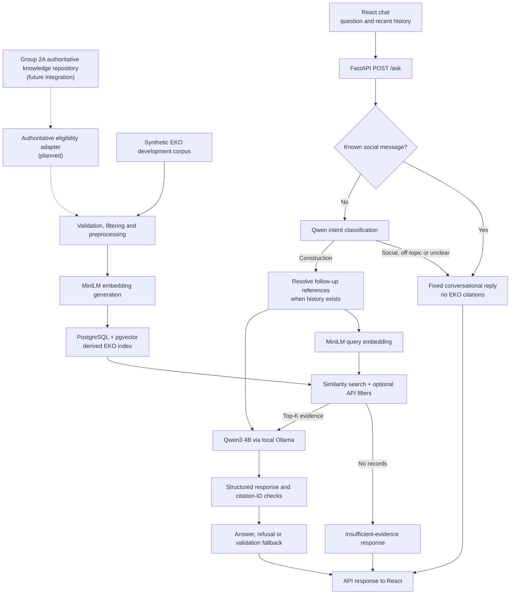

# SiteSeer Project 2B
# Retrieval-Augmented Generation Architecture and Design

| Document control | Details |
|---|---|
| Project | AI Query Layer — Knowledge Corpus Intelligence |
| Project group | SiteSeer Project 2B |
| Industry partner | SiteSeer Pty Ltd |
| Document classification | Technical architecture and design |
| Version | 1.1 — Draft |
| Prepared | 12 October 2026 |
| Revised | 15 November 2026 |
| Status | Local conversational prototype implemented; current routing evaluation and Group 2A integration pending |
| Intended audience | SiteSeer technical stakeholders, academic assessors, future developers and maintainers |

## Executive Summary

SiteSeer Project 2B develops an artificial intelligence query layer that makes structured construction knowledge accessible through natural-language questions. The proposed long-term system must answer using authoritative, approved SiteSeer knowledge rather than treating a language model’s general training as a source of construction guidance. This document records the design of the current retrieval-augmented generation (RAG) prototype, explains its principal technical decisions and defines the remaining integration requirements.

The implemented prototype converts questions into vector embeddings using `sentence-transformers/all-MiniLM-L6-v2`, retrieves relevant synthetic Educational Knowledge Objects (EKOs) from PostgreSQL with pgvector, and supplies the retrieved evidence to a locally hosted Qwen3 4B model through Ollama. The generation layer produces a structured answer or an insufficient-evidence response. Citation validation rejects references to EKO identifiers that were not retrieved. Metadata filters can constrain retrieval by construction stage, trade, jurisdiction and learner level.

A historical 40-case synthetic end-to-end evaluation, recorded before the conversational interface and message-routing additions, reported retrieval hits for all 35 answerable cases at ranks 1 and 3, successful answered-status and citation checks for those 35 cases, and insufficient-evidence responses for five designated unanswerable cases. Five additional manual smoke tests examined answer generation, refusal, positive filtering, fabricated-citation rejection and negative filtering. These observations establish a useful technical baseline; they do not demonstrate independent claim-level factual correctness or performance on authentic SiteSeer knowledge.

Group 2A remains the authoritative owner of the knowledge schema, validation workflow and query interface. At the time of writing, its approved EKO interface and production-eligible data have not been delivered to Group 2B. The React learner interface and FastAPI backend are now implemented for a local demonstration. Real-data integration, authoritative publication and supersession enforcement, relationship-aware retrieval and domain-expert review remain incomplete or unverified. The document distinguishes these planned capabilities from functions demonstrated in the current prototype.

## 1. Introduction

The current application adds a React chat interface and FastAPI API around the retrieval pipeline. Common greetings receive fixed replies; other messages are classified before retrieval. Construction follow-ups are rewritten using recent conversation context, then answered from freshly retrieved EKOs. Conversation state is temporary and held in the browser, not stored as server-side chat sessions.

### 1.1 Purpose and Audience

This document describes the logical architecture, component boundaries, information flow, technology choices, evaluation approach and intended operational controls of the SiteSeer Project 2B RAG system. It is intended to serve as a durable technical reference for implementation decisions, cross-group integration and final handover. It complements, rather than replaces, the implementation instructions in `backend/llm/README.md` and `backend/semantic_search/README.md`.

### 1.2 Project Context

SiteSeer’s knowledge methodology separates source evidence, structured professional decisions and educationally usable knowledge. Evidence Records (EVDs) capture source material; Construction Decision Objects (CDOs) organise decisions and their supporting evidence; Educational Knowledge Objects (EKOs) present approved knowledge for learning and retrieval. The knowledge may contain L1–L5 information describing factual, procedural, conditional, judgement-related and dependency aspects, subject to the authoritative methodology and schema.

Project 2A is responsible for the authoritative data model and interfaces through which eligible knowledge can be accessed. Project 2B is responsible for the AI query layer: semantic search, evidence retrieval, constrained generation, traceable responses and a demonstration of the AI tutor concept. The vector index is a derived search artefact, not an alternative system of record.

### 1.3 Objectives and Design Principles

The architecture seeks to make approved construction knowledge discoverable through natural-language questions, preserve the provenance of cited knowledge, avoid unsupported responses when evidence is insufficient, and remain adaptable to changes in the authoritative knowledge store. Its design principles are evidence-first generation, strict separation of authoritative and derived data, explicit uncertainty, reproducibility, replaceable technical components and transparent reporting of limitations.

### 1.4 Scope and Maturity

The current implementation includes a local embedding pipeline, a PostgreSQL/pgvector index over synthetic search-ready EKOs, semantic similarity retrieval, optional metadata filters, a local Qwen3 generation layer, response-status handling, citation-identifier validation and repeatable synthetic evaluation. It also includes a React/Vite chat interface, FastAPI endpoints, temporary conversation history, follow-up rewriting and conversational routing. These features are implemented; broad live validation of the latest conversational workflow remains pending.

Approved EKO ingestion, integration with Group 2A’s schema and query contract, authoritative publication-status checks, automatic source-driven refresh, relationship expansion, expert evaluation and production deployment are planned or pending. They must not be represented as implemented acceptance criteria.

## 2. System Architecture

### 2.1 Logical Architecture

The system is organised into an offline preparation path and an online question-answering path. Preparation transforms eligible source records into a search representation and persists their embeddings. At query time, the system retrieves candidate knowledge, constructs an evidence-constrained prompt, generates an answer and validates the resulting citation references.

*Figure 1. Current local conversational architecture. Dotted paths denote planned Group 2A integration. API/model failures are returned separately as HTTP errors.*

### 2.2 Component Responsibilities

| Component | Responsibility | Current implementation or state |
|---|---|---|
| Data preparation | Convert development EKOs into searchable records | Synthetic-data preprocessing workflow |
| Embedding model | Map knowledge text and questions into a shared vector space | `all-MiniLM-L6-v2`, 384 dimensions |
| Vector store | Store embeddings with EKO identifiers and metadata | PostgreSQL with pgvector |
| Retrieval service | Rank semantically similar records and apply metadata restrictions | `backend/semantic_search/search_pgvector.py` |
| RAG orchestration | Assemble evidence, invoke generation and validate the result | `backend/llm/rag_pipeline.py` |
| Generation service | Produce an answer constrained by retrieved evidence | Local Ollama, `qwen3:4b-q4_K_M` |
| Evaluation | Measure retrieval, response and citation-check behaviour | Fixed-evidence and end-to-end scripts |
| Authoritative EKO interface | Supply approved, versioned, queryable knowledge | Pending Group 2A contract |
| Learner-facing interface | Present conversation turns, answers and cited source titles | React 19, Vite 6, `frontend/src/main.jsx` |
| Application API | Validate requests and invoke RAG | FastAPI, Pydantic and Uvicorn, `backend/main.py` |
| Conversational routing | Separate social/scope messages from construction questions | `backend/llm/conversation.py` |
| Follow-up resolution | Rewrite contextual questions before fresh retrieval | `resolve_question()` in `backend/llm/rag_pipeline.py` |

### 2.3 End-to-End Request Flow

The React frontend sends the question and recent conversation history to `POST /ask`. The API supports optional exact-match stage, trade, jurisdiction and learner-level filters, but the current frontend does not send filters.

Known whole-message greetings, thanks, wellbeing and capability questions receive fixed replies before a database connection is opened. Other messages enter the RAG orchestrator, where Qwen classifies intent. Social, unrelated or unclear messages receive a predefined conversational reply with no retrieved sources. Construction questions continue to retrieval; when history exists, a separate Qwen call rewrites the latest question into a standalone question.

MiniLM embeds the standalone question. PostgreSQL applies optional metadata conditions and ranks matching EKOs by cosine distance. No matching records produces an immediate insufficient-evidence response. Otherwise, the retrieved knowledge text and standalone question are sent to Qwen for answer generation. The raw conversation is not supplied to this final generation step as evidence. Response parsing and citation-ID checks produce an answer, refusal or validation fallback, returned to React.

Default retrieval depth is three records. The CLI can change it; the current API request model does not expose `top_k`. This is a baseline rather than a proven optimum.

### 2.4 Conversation State and Interface

The React interface keeps conversation turns in component memory, clearing them on refresh or **New chat**. It uses neither browser persistence nor server-side chat storage. The frontend sends the last three non-conversational exchanges (six messages), truncating prior assistant messages to 6,000 characters. Older turns remain visible but are not included in model context. API history entries accept only `user` or `assistant` roles, with at most six messages of 6,000 characters each; the current question is limited to 2,000 characters.

Each answer retains its own citation links and source-title cards. Failed HTTP requests preserve earlier turns and restore the question for retry. The frontend prevents another submission or New chat while a response is pending. Responses are displayed as plain text with recognised citation links, not arbitrary model-generated HTML. Follow-up interpretation is model-based and can be incorrect; the presence of conversation history does not establish factual support.

## 3. Knowledge and Data Architecture

### 3.1 Authoritative and Derived Data

The authoritative knowledge repository belongs to Group 2A. Project 2B should ingest only the content approved for the intended learner-facing use. Raw EVDs, draft or unvalidated CDOs, personally identifying expert material, confidential documents and superseded or unverified knowledge must not be indiscriminately exposed through the learner index.

The vector store is disposable and rebuildable. It must not become the source of truth for publication decisions, content corrections or provenance. Changes to an authoritative EKO should be reflected through a controlled refresh of the derived index rather than manual editing of embedded knowledge.

### 3.2 Search Representation

The synthetic pipeline uses searchable text together with identifying and filtering metadata. The currently demonstrated retrieval fields include EKO identifier, title, construction stage, trade, jurisdiction, learner level and version, with an embedding used for similarity ranking. This is a development representation and must not be assumed to match Group 2A’s final schema.

The initial approach represents each eligible search-ready record in a form suitable for whole-record retrieval. Field-level indexing of L1–L5 content, hybrid lexical/semantic retrieval and relationship expansion remain design alternatives for evaluation against the real corpus.

### 3.3 Metadata and Publication Controls

The current search service supports exact-match filtering for stage, trade, jurisdiction and learner level. These filters are applied as SQL conditions before vector ranking. A matching metadata field does not itself establish that a record is approved for publication.

The real integration must additionally interpret Group 2A’s authoritative publication status, validation status, standards-verification status, jurisdiction applicability, effective version and supersession relationships. Eligibility decisions should be made using authoritative fields and agreed business rules before records enter the learner index, with safeguards against stale content remaining retrievable after withdrawal or replacement.

### 3.4 Data Lifecycle and Re-indexing

For the current prototype, synthetic records are preprocessed, embedded and indexed locally. The indexer synchronises a complete search-ready snapshot: it inserts or updates current records and deletes rows absent from that snapshot. It verifies the expected IDs and dimensions before committing, and rolls back on failure. This is a manually invoked snapshot refresh, not an automatic Group 2A update subscription; partial exports must not be treated as complete snapshots. For the intended integrated system, the lifecycle should begin with a documented Group 2A export or query interface, followed by eligibility checks, field mapping, deterministic searchable-text construction, embedding generation and idempotent index updates.

A publication or revision should trigger an index update without changing the RAG application code. A withdrawn or superseded record should be removed from the active retrieval set or made ineligible through a verified mechanism. The exact trigger, refresh interval, deletion policy and consistency guarantees are **not yet agreed** and require joint design with Group 2A.

## 4. Embedding and Retrieval Design

### 4.1 Embedding Model

The prototype uses `sentence-transformers/all-MiniLM-L6-v2`, a local sentence-embedding model producing 384-dimensional vectors. The choice supports low-cost, reproducible experimentation on a development laptop without per-query embedding API charges. It is a provisional engineering choice; domain vocabulary coverage and retrieval quality must be reassessed using approved construction knowledge.

### 4.2 Vector Storage and Ranking

PostgreSQL with pgvector stores the vector representation alongside searchable EKO metadata. Query ranking uses pgvector cosine distance, with similarity reported as `1 - cosine_distance` in the demonstrated retrieval path. These scores are useful for ordering candidate records but must not be interpreted as calibrated probabilities that an answer is correct.

PostgreSQL was selected as a practical local prototype store with SQL metadata filtering and a direct integration path to structured records. This does not preclude future use of a different embedding provider or vector backend.

### 4.3 Structured Filters and Evidence Selection

The retrieval implementation combines vector similarity with optional exact-match metadata constraints. The SQL conditions use parameterised values for user-supplied filters. A positive-filter smoke test returned only records matching the requested stage and trade; a negative-filter smoke test returned no records for a deliberately nonexistent stage and produced an insufficient-evidence response.

The current top-K ranking provides candidate evidence, not an independent determination that the content is sufficient, current or authoritative. Threshold calibration, reranking and field-specific retrieval remain potential refinements requiring a representative labelled dataset.

### 4.4 Relationship-Aware Retrieval

The Project 2B scope anticipates retrieval by relationship chain, including dependencies among construction decisions or knowledge objects. A future retrieval stage may resolve linked records after initial semantic retrieval and add relevant dependency context to the prompt. This should respect direction, validation and applicability of relationships supplied by Group 2A. No relationship-expansion capability is claimed as verified in the current prototype.

## 5. Generation and Response Architecture

### 5.1 Model Selection

The prototype uses `qwen3:4b-q4_K_M` through a locally running Ollama service. Recorded generation settings include `temperature=0`, `num_predict=512`, `think=false` and non-streaming requests. These settings favour repeatable development testing, although temperature zero does not guarantee identical outputs across all environments.

A fixed-evidence development comparison considered local Qwen3 4B, local Gemma3 4B and hosted GPT-4.1 mini. Qwen3 was retained provisionally because it performed well on the defined citation and refusal checks while avoiding hosted inference charges. This is not a universal claim that it is the best model for real construction questions.

### 5.2 Evidence-Constrained Prompting

The generation stage receives the standalone learner question and context assembled from retrieved EKO records. Retrieval count bounds the number of objects, but the application does not enforce an explicit token budget on their combined text. Conversation-message limits do not guarantee that the evidence fits the model context window. The prompt instructs the model to rely on supplied evidence, avoid inventing standards or technical details, and refuse questions that cannot be answered adequately from the retrieved material. Retrieved text is evidence to analyse, not a source of executable instructions.

Prompt design is a risk-reduction measure rather than a proof of factual grounding. Even a valid-looking response may contain a claim not entailed by its citation.

### 5.3 Structured Responses and Failure Behaviour

The model is instructed to return a JSON object containing `status` and `answer`. The orchestration layer recognises answered and insufficient-evidence outcomes and applies response and citation checks. Invalid output or failed citation validation is handled through a safe fallback rather than passing the untrusted response through unchanged.

The implementation distinguishes at least the following internal outcomes:

| Status | Interpretation |
|---|---|
| `conversational` | Fixed social, capability, scope or clarification reply; no EKO evidence or citations |
| `answered` | A generated answer passed the implemented response and citation-ID checks |
| `insufficient_evidence` | Retrieved evidence was absent or judged insufficient for an answer |
| `invalid_model_response` | The model response failed structural validation |
| `citation_validation_failed` | Citation checking failed and a safe fallback was used |

The FastAPI response exposes `answer`, `status`, cited ID list `sources`, and `retrieval` entries containing ID, title and similarity score. It does not currently return full EKO text or source versions. These statuses should be retained in future application logs and evaluation reports, with the distinction between format validation and factual verification made explicit.

### 5.4 Conversational Routing

`conversation.py` first applies whole-message matching for common social messages. A greeting attached to a construction question must not be consumed by this shortcut. Other messages are classified by Qwen into `construction`, `greeting`, `wellbeing`, `thanks`, `goodbye`, `capabilities`, `off_topic` or `clarify`. Non-construction categories map to fixed replies rather than unrestricted general-knowledge generation. Invalid classifier JSON or unsupported intent values produce a clarification reply; transport failures still reach the API error handler.

Construction follow-ups remain eligible for retrieval. The frontend excludes conversational replies from subsequent construction history so a greeting does not displace useful construction context. Routing and rewriting are model judgments, not guaranteed relevance checks, and require live evaluation on mixed messages, topic changes and ambiguous follow-ups.

## 6. Grounding, Citations and Safety

### 6.1 Citation Integrity

The current validator checks that cited EKO identifiers belong to the retrieved evidence set and conform to the expected development citation syntax. A manual negative test using a fabricated `MOCK-KO-999` citation produced a `ValueError`, confirming rejection of a reference not included in the allowed set.

This is **identifier-level citation validation**, not independent proof that a cited passage supports every sentence of the answer. Claim-level grounding must be assessed separately through expert review or an appropriately validated evaluation method.

### 6.2 Insufficient Evidence

When no eligible records are retrieved, the system should not answer from the model’s general knowledge as though it came from SiteSeer. The observed negative-filter test produced the response “The available EKO evidence is insufficient to answer this question.” An additional smoke test asking for exact temporary-bracing bolt dimensions refused to invent unsupported specifications.

These tests cover specific cases only. They do not establish complete resistance to hallucination or unsafe construction advice.

### 6.3 Construction-Domain Risk Controls

Construction questions may involve safety, compliance and jurisdiction-specific standards. The system should not convert a high similarity score into an assertion of regulatory correctness. The integrated system must preserve jurisdiction and standards-verification metadata, display source references clearly and avoid presenting unverified standards claims as authoritative requirements.

The prototype is a learning and demonstration system, not a substitute for competent professional judgement, site-specific engineering review or authoritative regulatory advice.

### 6.4 Confidentiality and Access

The current synthetic dataset is suitable for development and repository-based collaboration. Authentic SiteSeer content requires compliance with project confidentiality and intellectual-property obligations. Secrets and access credentials must remain outside source control. Authentication, authorisation, audit logging, retention, encryption and hosting controls require explicit design before any deployment involving protected client data.

## 7. Group 2A Integration Architecture

### 7.1 Dependency and Contract

Group 2A must supply the agreed knowledge schema and a documented interface for retrieving approved EKOs. Project 2B requires stable record identifiers, readable educational content, metadata needed for filtering, publication and validation state, version and supersession information, jurisdiction applicability and any approved relationship references. The precise field names, endpoint design and payload structure are **pending**.

The original scope also calls for access by ID, by stage, by relationship chain and in bulk for embedding. These requirements should be verified jointly against the eventual interface rather than assumed to be supported.

### 7.2 Proposed Integration Boundary

An adapter between the authoritative Group 2A interface and Project 2B’s internal search representation is recommended. It would validate incoming fields, enforce agreed eligibility rules, map content to searchable text, preserve source identifiers and versions, and submit only eligible records for embedding. This boundary would isolate downstream retrieval and generation code from future changes in Group 2A’s physical database design.

The adapter is a **proposed component**, not an existing verified integration.

### 7.3 Integration Acceptance Tests

The integrated system should demonstrate that a newly published EKO becomes searchable after refresh, a superseded or withdrawn record is excluded, an ineligible draft never enters the learner index, and an unchanged application can handle a routine content update. Additional tests should confirm citation resolution to authoritative records, jurisdiction filtering, relationship traversal where supported and controlled behaviour when required metadata is missing.

The final schema contract, test fixtures and approval of test records must be agreed with Group 2A and the client before these checks can be signed off.

## 8. Technology Decisions and Trade-offs

| Decision | Current choice | Rationale and limitations |
|---|---|---|
| Embeddings | Local MiniLM, 384 dimensions | Accessible, reproducible and lightweight; requires real-domain retrieval validation |
| Vector database | PostgreSQL + pgvector | SQL metadata filtering and a familiar relational platform; production scale and indexing strategy untested |
| Generation | Local Qwen3 4B via Ollama | Local-first experimentation and no per-call hosted fee; answer quality requires expert assessment |
| Frontend | React 19, JavaScript, CSS and Vite 6 | Local conversational UI; temporary in-memory history |
| Backend API | FastAPI, Pydantic and Uvicorn | Minimal local HTTP interface with request validation |
| Orchestration | Python implementation | Direct control over retrieval, prompting and validation; integration and maintainability need continued review |
| Retrieval depth | Default top 3 | Simple, measurable baseline; not necessarily optimal for complex multi-object questions |
| Evidence format | Synthetic search-ready EKOs | Enables early testing; not equivalent to authoritative Group 2A EKOs |

The architecture deliberately separates embeddings, vector retrieval and generation so that each can be replaced or re-evaluated without redefining the authoritative knowledge model. Actual interchangeability should be demonstrated with integration tests rather than inferred from modular code organisation alone.

## 9. Evaluation and Verification

### 9.1 Evaluation Strategy

The current evaluation has two complementary paths. Fixed-evidence testing isolates the language model by supplying predefined question-and-context pairs. End-to-end testing includes question embedding, pgvector retrieval, context assembly, local generation and output validation. The latter is the stronger indication that the components work together, but both currently use synthetic data.

### 9.2 Fixed-Evidence Model Comparison

The recorded development comparison comprised 35 answerable and five insufficient-evidence cases. All three compared models produced expected citations for the 35 answerable cases. Qwen3 and GPT-4.1 mini recorded zero unsupported citation identifiers in the defined check, while Gemma3 recorded five. All three passed the five designated refusal checks. Mean observed latencies were 5.923 seconds for Qwen3, 5.149 seconds for Gemma3 and 1.615 seconds for GPT-4.1 mini. These timings are environment-dependent and not directly generalisable.

### 9.3 End-to-End Synthetic Results

The historical prompt-v2 end-to-end evaluation produced the following results before follow-up rewriting and conversational routing were added:

| Measure | Observed result |
|---|---:|
| Total synthetic cases | 40 |
| Answerable / insufficient-evidence cases | 35 / 5 |
| Retrieval Hit@1, answerable set | 35/35 |
| Retrieval Hit@3, answerable set | 35/35 |
| Answerable cases returning `answered` | 35/35 |
| Answerable cases with citations | 35/35 |
| Designated insufficient cases refused | 5/5 |
| Citation validation failures | 0 |
| Invalid model responses | 0 |
| Cases citing outside retrieved evidence | 0 |
| Mean per-case latency | 5.783 seconds |

The reference result file is `data/evaluation/results/end_to_end_qwen3_4b_prompt_v2.json`. The 40/40 outcome refers to these defined synthetic checks, **not** a verified 100% factual accuracy rate. These saved results do not validate the current classifier, chat history, question rewriting, HTTP API or frontend, and the latency must not be presented as a measurement of the revised workflow.

### 9.4 Manual Smoke Tests

Five manual tests were performed against the development system. A slab pre-pour question produced an answer with retrieved EKO references. A question requiring exact temporary-bracing dimensions was refused for lack of evidence. A positive stage-and-trade filter was confirmed through the retrieval output and SQL filter logic. A fabricated citation identifier was rejected by the validator. A nonexistent stage filter returned no evidence and produced an insufficient-evidence response.

Together these tests support the documented behaviour of the prototype but do not replace systematic domain-expert validation.

### 9.5 Current Conversational Checks

Development checks have exercised API history forwarding and input bounds, mocked follow-up rewriting and fresh retrieval, and frontend build compilation. Five automated tests in `backend/llm/test_conversation.py` cover direct social shortcuts, mixed-message shortcut avoidance, mocked construction routing with history, off-topic replies and malformed classification output. API greeting smoke checks confirmed conversational replies without database/model calls.

These checks validate code paths, not live Qwen intent accuracy or browser-to-model behaviour. The historical 40-case benchmark must be rerun for the revised pipeline, alongside live conversation tests for greetings, mixed requests, unrelated questions, ambiguous references and topic changes. Client feedback and claim-level review remain separate from automated status/citation checks.

### 9.6 Remaining Evaluation Requirements

Real-data evaluation should use approved EKOs and a labelled set of representative construction questions, including ambiguous, multi-step, jurisdiction-sensitive and deliberately unanswerable cases. Sean and Darcy or other designated domain experts should review whether each answer is substantively supported by its sources. Evaluation should also examine publication eligibility, supersession, missing metadata, response latency, operational cost and repeatability across model and prompt versions.

A corpus-gap report should distinguish missing knowledge from retrieval failures and generation failures. That reporting capability is part of the project scope but is not claimed as completed here.

## 10. Deployment, Operations and Reproducibility

### 10.1 Current Development Environment

The current prototype runs locally using a React/Vite frontend, FastAPI/Uvicorn backend, PostgreSQL with pgvector, a sentence-transformer embedding model and an Ollama model server. Vite normally runs at `http://127.0.0.1:5173`, FastAPI at `http://127.0.0.1:8000`, and the backend calls Ollama at `http://127.0.0.1:11434/api/chat`. No hosted model or cloud deployment is configured in the current runtime. Configuration is held in local environment settings, with repository documentation describing prerequisites and startup. The database and installed model weights are not supplied as a ready-to-run service through the Git repository.

The API loads MiniLM once during startup and opens/closes a database connection for each non-shortcut question request. `GET /health` reports API liveness only, not database or Ollama readiness. `POST /ask` returns HTTP 200 for application outcomes, including conversational replies and refusals; request validation errors use HTTP 422, and exceptions caught around pipeline execution use HTTP 503 with a generic message and server-side logging.

CORS allows local frontend origins on ports 5173 and 3000. The frontend API base URL is configurable through `VITE_API_URL`. Authentication, persistent chat sessions and hosted infrastructure are not implemented. Local CORS configuration is not authentication.

### 10.2 Configuration and Traceability

For reproducibility, the final handover should identify the exact embedding model, generation model and quantisation, prompt version, retrieval depth, metadata filters, corpus/index version, evaluation dataset and software dependencies. The client acceptance criteria also call for recording model, prompt and retrieval settings for every response. The existence of all such per-request operational logging is **not verified** by the current documentation and remains a completion check.

### 10.3 Performance and Cost

The recorded 5.783-second mean latency reflects one synthetic benchmark in a local development environment. It should not be treated as a service-level guarantee. Local inference avoids per-request hosted-model fees but incurs compute, storage and maintenance costs. A future deployment decision should compare supported hardware, concurrency, responsiveness, data residency, ongoing maintenance and any hosted-service charges.

Current model-call counts differ by route: recognised social shortcuts use no generation calls; other conversational replies normally use one classification call; construction questions normally use classification and answer generation; construction requests with history add rewriting. Each call has a 120-second timeout. The browser waits up to seven minutes, and aborting its request does not cancel backend inference. These are timeout settings, not latency guarantees.

### 10.4 Failure Recovery

The application should fail safely if the database is unavailable, Ollama cannot be reached, evidence is missing or the model returns malformed content. Index reconstruction should be possible from the authoritative EKO source and documented embedding configuration. Backup, recovery, monitoring and production access controls have not been validated as completed.

## 11. Limitations, Risks and Planned Development

The principal limitation is that the system has been exercised with synthetic records rather than approved SiteSeer EKOs. This creates uncertainty around real schema compatibility, publication rules, construction vocabulary, standards applicability and expert-rated answer quality. Other limitations include the absence of independently verified claim-level grounding, unconfirmed relationship traversal, limited live validation of the implemented chat interface and conversational routing, and the lack of demonstrated automatic updates from Group 2A.

The most immediate project dependency is the delivery of Group 2A’s approved query contract and usable EKO examples. Work that does not depend on this interface can proceed in parallel, including refinement of the tutor interface and conversational routing, refinement of the evaluation rubric, architecture review and preparation of integration tests. Real-data acceptance cannot be declared until the interface, eligibility rules and expert-reviewed tests are completed.

The architecture should be updated after integration to replace proposed interface descriptions with agreed schemas, verified workflows, diagrams reflecting the deployed components and measured results from authentic content.

## 12. Handover and Acceptance Alignment

The scope identifies the RAG architecture document as a critical deliverable independent of the prototype’s maturity. This document provides the baseline design record, but final acceptance of the overall Project 2B system requires evidence beyond the document itself.

| Client acceptance expectation | Current assessment |
|---|---|
| Reproducible indexing of approved SiteSeer content | Pending real EKO access |
| Relevant retrieval on a labelled set | Demonstrated on synthetic set only |
| Traceable citation identifiers | Implemented and tested on synthetic records |
| Refusal when evidence is insufficient | Demonstrated in defined synthetic tests |
| Exclusion of drafts and superseded knowledge | Requires authoritative Group 2A integration |
| Claim-level grounding | Not independently established |
| Local learner chat and API | Implemented; broader live conversational verification pending |
| Per-response model, prompt and retrieval logging | Not verified as complete |
| Latency and cost reporting | Development latency recorded; broader cost reporting pending |
| New published KO searchable without code changes | Pending integration test |
| Replaceable embedding and vector components | Architectural intention; substitution not yet demonstrated |

For final handover, the team should deliver the revised architecture document, code repository, environment and setup instructions, agreed Group 2A interface contract, representative test dataset and evaluation report, known limitations and a live demonstration of the learner-facing workflow.

## 13. References and Implementation Evidence

### 13.1 Project and Client Documents

**SiteSeer WIL Project 2B — Scope of Work: AI Query Layer — Knowledge Corpus Intelligence.** Primary source for deliverables, integration gates, proposed workplan and acceptance criteria.

**SiteSeer Methodology Manual v1.1.** Background source for SiteSeer knowledge methodology and the EVD/CDO/EKO distinction. Specific authoritative schema mappings must be confirmed against Group 2A’s agreed interface.

**SiteSeer WIL Project Briefing — Week 1.** Project context and stakeholder expectations.

### 13.2 Repository Documentation and Code

| Repository path | Role |
|---|---|
| `backend/llm/README.md` | RAG setup, behaviour and evaluation instructions |
| `backend/README.md` | API setup, request/response contract and conversation limits |
| `backend/main.py` | FastAPI endpoints, validation and lifecycle |
| `backend/llm/conversation.py` | Social shortcuts and model-based intent classification |
| `backend/llm/test_conversation.py` | Offline routing checks with mocked classification |
| `frontend/README.md` | Local frontend setup and chat behaviour |
| `frontend/src/main.jsx` | React conversation state, API requests and answer rendering |
| `frontend/src/styles.css` | Responsive red, white and black interface styling |
| `backend/semantic_search/README.md` | Embedding, indexing and retrieval instructions |
| `backend/llm/rag_pipeline.py` | RAG orchestration and response validation |
| `backend/semantic_search/search_pgvector.py` | Semantic retrieval and metadata filters |
| `backend/semantic_search/index_pgvector.py` | Development index loading |
| `backend/llm/evaluate_end_to_end_rag.py` | End-to-end evaluation runner |
| `backend/llm/run_rag_benchmark.py` | Fixed-evidence local-model benchmark |
| `data/evaluation/results/end_to_end_qwen3_4b_prompt_v2.json` | Recorded final synthetic benchmark |
| `docs/mock_eko_schema.md` | Development mock schema, not an authoritative Group 2A contract |
| `docs/data_dictionary.md` | Existing project data dictionary |

### 13.3 Document Maintenance

Version 1.0 documented the original local RAG baseline on 12 October 2026. Version 1.1, revised 15 November 2026, adds the implemented React/FastAPI application, temporary conversation context, intent routing, follow-up rewriting and snapshot index refresh, while retaining earlier evaluation results as historical evidence. Group 2A integration remains pending. Subsequent revisions should record the agreed interface, implementation changes, client decisions, verified acceptance tests and any departures from the design. A final version should be reviewed against the actual repository and demonstrated system before formal handover.

---

*End of document.*
